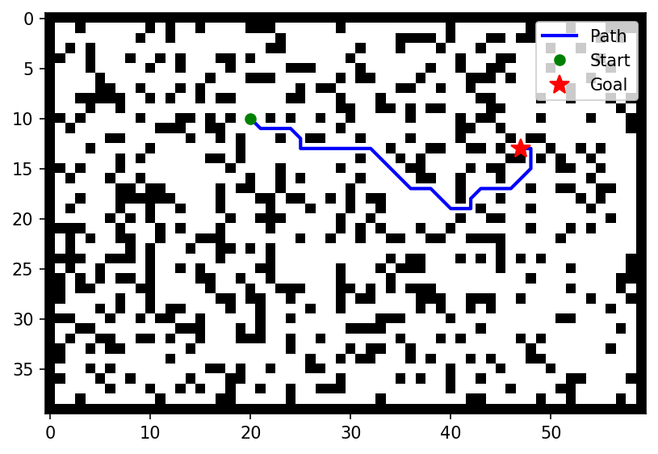

# Grid Robot Path Planner

A Python grid path planner that compares Dijkstra and A* on seeded random maps. Even though A* finds the same optimal path, it expands about 4.4 times fewer nodes. 

## Results

Both planners were run on the same 400 seeded random maps (60×40 cells, 100 maps
at each obstacle density). Reproduce with `python -m gridnav.benchmark`;
raw data is in [`results/benchmark.csv`](results/benchmark.csv).

| Obstacle density | Dijkstra nodes expanded | A* nodes expanded | Reduction | Dijkstra time (ms) | A* time (ms) | Mean path cost |
|---|---|---|---|---|---|---|
| 0.10 | 939 | 92 | **10.2×** | 6.39 | 0.67 | 26.66 |
| 0.20 | 857 | 134 | **6.4×** | 5.31 | 0.88 | 29.81 |
| 0.30 | 794 | 240 | **3.3×** | 4.37 | 1.40 | 38.59 |
| 0.35 | 596 | 251 | **2.4×** | 3.22 | 1.42 | 41.07 |

Across all 400 maps, A* expanded **4.4× fewer nodes** than Dijkstra, and on every
map both planners returned the same path cost (the largest difference was ~1e-14,
floating-point rounding). Values are means per map.

**Why the advantage shrinks as density rises.** A* uses octile distance to estimate
the remaining cost. On open maps that estimate is close to the true cost, so A*
heads almost straight for the goal. As walls increase, paths need detours the
estimate can't predict (mean path cost rises from 26.7 to 41.1), so A* has to
explore more. Dijkstra's count falls for a different reason: denser maps have
fewer free cells to visit before it reaches the goal.

## How it works
- The grid allows 8-connected moves, diagonal cost √2, and no cutting corners past walls.
- Maps come from a seeded random generator and guaranteed solvable (BFS check, then retry).
- Planners share one search function and Dijkstra is equivalent in logic to A* with a zero heuristic.
- Heuristic is Octile distance because it doesn't explore as many cells as Euclidean distance(undersestimating doesn't lead search as well) and also doesn't overestimate diagonal costs such as Manhatten distance(cost = 2 instead of correct sqrt(2)). 

## Running it
    python -m pytest
    python -m gridnav.benchmark
    python demo.py

## Next steps
Obstacle inflation, path smoothing
